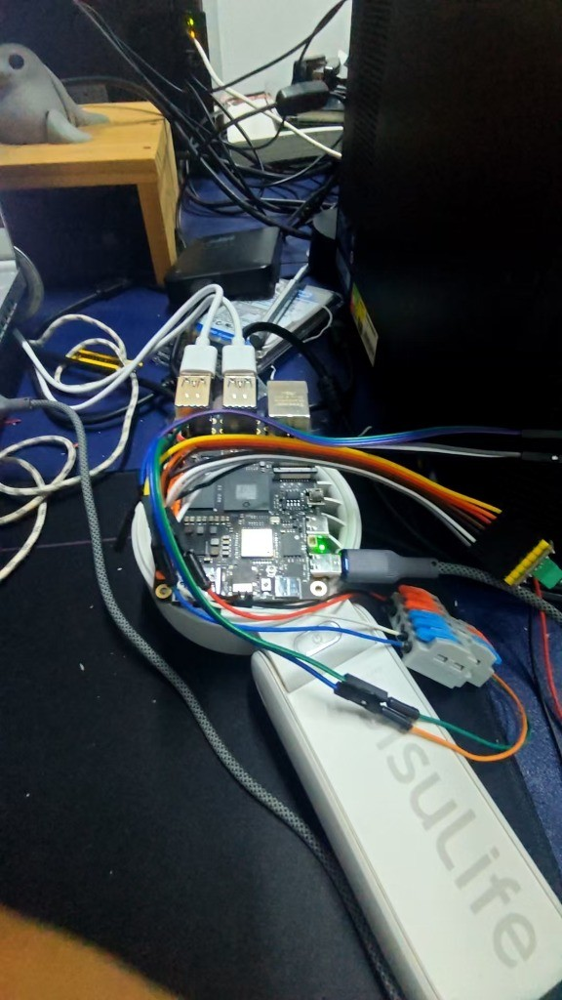
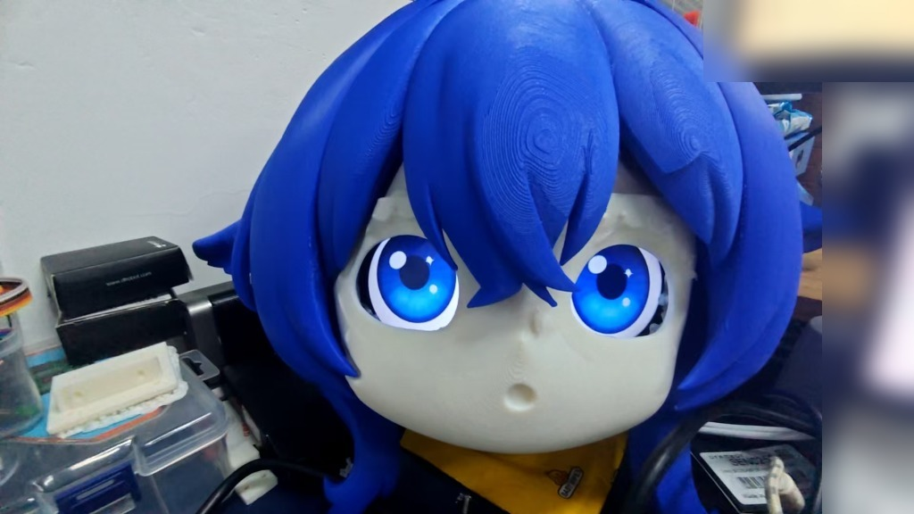

# AURA-X5: Embodied Proactive Desktop AI Co-Pilot on D-Robotics RDK X5

> **Robotics Dream Keeper Challenge — 2026 Winter**  
> **Hardware Baseline:** D-Robotics RDK X5 (10 TOPS Bayes BPU + 8-Core Cortex-A55)  
> **License:** MIT ([LICENSE](./LICENSE))  
> **Single Source of Truth (Hardware/Protocol Contract):** [`interfaces.json`](./interfaces.json)

AURA-X5 is a desktop embodied proactive AI agent device powered by **D-Robotics RDK X5**. Instead of running intrusive pop-ups and heavy vision loops on the host PC, AURA-X5 offloads edge perception to the RDK X5 10-TOPS BPU, coordinates subsystems via **ROS 2**, displays non-intrusive proactive suggestions on a dedicated secondary screen (60 FPS HDMI UI or 3.5" SPI touchscreen), and enforces **hardware-level privacy (DPDT physical power-cut)** plus **physical action approval (EC11 rotary encoder / touch + Emergency Kill-Switch)** before injecting any USB-C HID keyboard/mouse actions to the host PC.

---

## Why AURA-X5? (Beyond Stock Demos)

| Pain Point of Software-Only Desktop Agents | AURA-X5 Hardware + Edge-AI Solution |
|---|---|
| Continuous screen/camera perception drains PC GPU/CPU and raises privacy concerns | **10 TOPS BPU offloading** on RDK X5 (`hbm_runtime`) + **DPDT hardware privacy switch** physically severing `V_PRIVACY_3V3` to mic/camera |
| Pop-up notifications interrupt flow on the main monitor | **Dedicated 15° desktop console** (V2 60 FPS HDMI kiosk UI or V1 3.5" 480×320 SPI touch) + WS2812B ambient status ring |
| Software-simulated mouse/keyboard is fragile and lacks a physical e-stop | **USB-C OTG Composite Gadget** (`ecm.usb0` + `/dev/hidg0` + `/dev/hidg1`) gated by **physical approval** and **hardware Kill-Switch (<50 ms abort)** |
| Ad-hoc scripts lack robotic modularity and observability | Full **ROS 2 node graph** (`/aura_sensor_node`, `/aura_bpu_perception_node`, `/aura_safety_gate_node`, `/aura_actuator_ui_bridge_node`) |

---

## Challenge Deliverables Navigation (Stages 1–3)

| Stage | Official Deliverable | Project File |
|---|---|---|
| **Stage 1 — Ignite** | Bring-up, SSH, Sensor/Peripheral Proof, First BPU AI Task | [`docs/STAGE1_IGNITE.md`](./docs/STAGE1_IGNITE.md) |
| **Stage 2 — Build** | Concept & Application Proposal | [`docs/PROPOSAL.md`](./docs/PROPOSAL.md) |
| **Stage 2 — Build** | System Architecture, Compute Plan & ROS 2 Node Graph | [`docs/ARCHITECTURE.md`](./docs/ARCHITECTURE.md) |
| **Stage 2 — Build** | Engineering Plan (Full BOM, Schedule, Top-5 Risks, Repo Layout) | [`docs/ENGINEERING_PLAN.md`](./docs/ENGINEERING_PLAN.md) |
| **Stage 2 — Build** | Public Project Roadmap | [`ROADMAP.md`](./ROADMAP.md) |
| **Stage 3 — Launch** | ROS 2 Package & Launch Files | [`ros2_ws/src/aura_x5_ros/`](./ros2_ws/src/aura_x5_ros/) |
| **Stage 3 — Launch** | Concurrent BPU Benchmark Script & Safety Manual | [`docs/BENCHMARKS_AND_SAFETY.md`](./docs/BENCHMARKS_AND_SAFETY.md) · [`scripts/benchmark_bpu_concurrent.py`](./scripts/benchmark_bpu_concurrent.py) |
| **Hardware (V1 & V2)** | Custom KiCad PCB (0 DRC errors), Gerber, 3D STEP/STL, V2 Solderless HDMI Guide | [`electronics/`](./electronics/) · [`mechanical/`](./mechanical/) · [`docs/02_manufacturing_and_assembly.md`](./docs/02_manufacturing_and_assembly.md) · [`docs/03_hdmi_solderless_guide.md`](./docs/03_hdmi_solderless_guide.md) |
| **Showcase PR** | Official Winter Challenge PR Template (for `D-Robotics/Robotics-Dream-Keeper-Challenge-Winter`) | [`showcase_pr/ParticipantName-Project-AURA-X5.md`](./showcase_pr/ParticipantName-Project-AURA-X5.md) |
| **Community (Advocator)** | External Content Plan (9+ technical posts & videos) | [`docs/ADVOCATOR_CONTENT_PLAN.md`](./docs/ADVOCATOR_CONTENT_PLAN.md) |

---

## Repository Structure

```text
aura_x5/
├── README.md                              # Project overview, quick start & troubleshooting
├── LICENSE                                # MIT License
├── ROADMAP.md                             # Stage 1–3 milestones & task board
├── interfaces.json                        # Hardware pinout (40-pin zero-conflict) & protocol contract
├── docs/
│   ├── STAGE1_IGNITE.md                   # Stage 1 bring-up, sensor & first AI evidence guide
│   ├── PROPOSAL.md                        # Stage 2 concept, users, innovation & measurable goals
│   ├── ARCHITECTURE.md                    # Stage 2 data-flow, module table, BPU/CPU plan & ROS 2 graph
│   ├── ENGINEERING_PLAN.md                # Stage 2 BOM, schedule, top-5 risks & repo plan
│   ├── BENCHMARKS_AND_SAFETY.md           # Stage 3 BPU concurrent benchmarks, calibration & e-stop safety
│   ├── ADVOCATOR_CONTENT_PLAN.md          # Community sharing plan (RDK Advocator / TOP Voice)
│   ├── 01_product_architecture.md         # Original EVT-A hardware architecture
│   ├── 02_manufacturing_and_assembly.md   # EVT-B PCB soldering & 3D print assembly guide
│   ├── 03_hdmi_solderless_guide.md        # V2 HDMI + 40-pin solderless DuPont wiring guide
│   └── evidence/                          # Stage 1–3 screenshots, rqt_graph & benchmark JSONs
├── ros2_ws/
│   └── src/aura_x5_ros/                   # ROS 2 Humble / TogetherROS package
│       ├── aura_x5_ros/
│       │   ├── sensor_node.py             # GPIO / Radar / I2C telemetry & Kill-Switch publisher
│       │   ├── bpu_perception_node.py     # Continuous RDK X5 BPU inference node (hbm_runtime)
│       │   ├── safety_gate_node.py        # Physical-approval & Kill-Switch state machine node
│       │   └── actuator_ui_bridge_node.py # USB-C HID actuator + HDMI/SPI UI bridge node
│       ├── launch/aura_x5.launch.py       # One-command multi-node ROS 2 launch file
│       └── config/aura_x5_params.yaml     # Pinned runtime parameters & safety thresholds
├── firmware/                              # Low-level RDK X5 drivers, BPU service, USB Gadget & UI servers
├── host/                                  # PC companion screen change observer & proactive engine
├── ui_web/                                # Offline self-contained 60 FPS HDMI kiosk web UI
├── electronics/                           # KiCad 9.0.7 schematics/PCB, DRC=0 validation, BOM & Gerber zip
├── mechanical/                            # CadQuery 2.8.0 STEP assembly & watertight 3D-print STLs
├── scripts/                               # Deployment, hardware probe & concurrent BPU benchmark tools
├── verification/                          # Automated unit test suite & physical bring-up checklist
└── showcase_pr/                           # Official challenge repository PR submission file
```

---

## Hardware Editions Supported

1. **Embodied Dual-Eye Companion Prototype (Live Physical Hardware)** — 3D-printed expressive robot head with dual glowing eye displays driven by RDK X5 + dual Espressif ESP32 + Arduino Uno + on-board I2S audio/mic (`docs/evidence/stage1/02a_rdk_x5_hardware_bringup.jpg`, `02b_embodied_dual_eye_prototype.jpg`).
2. **V2 HDMI + Solderless Edition (Fastest Demo & 60 FPS UI)** — Releases 100% of the RDK X5 40-pin header for direct female-to-female DuPont wiring of EC11 encoder, Kill-Switch, DPDT privacy switch, HLK-LD2410C mmWave radar, I2C sensors, and 5V cooling fan, paired with Chromium kiosk 60 FPS HDMI UI (`docs/03_hdmi_solderless_guide.md`).
3. **V1 Custom Carrier HAT (`aura_x5_hat`) + 3.5" SPI Touch + 3D Enclosure** — Complete 2-layer KiCad 9.0.7 PCB (32 parts, 36 nets, 0 DRC errors, Gerber & JLCPCB BOM ready) + 3 watertight CadQuery STL enclosure parts (`docs/02_manufacturing_and_assembly.md`).

| Live RDK X5 Bring-Up | Live 3D-Printed Embodied Dual-Eye Prototype |
|---|---|
|  |  |

---

## Quick Start (Clone, Build, Launch, Stop, Recovery)

### Prerequisites & Pinned Versions
- **RDK X5**: Official RDK OS (Ubuntu 22.04 / Linux 6.1.83), TogetherROS / ROS 2 Humble, `hbm_runtime 1.24.5` (HBRT `3.15.55.0`), Python 3.10+, `websockets`, `numpy`, `pillow`, `smbus2` (optional for I2C), `Hobot.GPIO`.
- **Host PC (Windows 11 / Linux)**: Python 3.10+, `numpy`, `pillow`, `websockets`, `paramiko` (for SSH deployment).
- **Secrets Policy**: Never commit board credentials or API keys. Pass them exclusively via environment variables (`RDK_HOST`, `RDK_USER`, `RDK_PASS`, `MODELSCOPE_API_KEY`).

### 1. Clone & Verify Locally (Host PC)
```bash
git clone https://github.com/147qaz258-ead/AURA-X5.git
cd AURA-X5
python3 verification/test_aura_x5.py
```

### 2. Deploy & Configure USB-C Composite Gadget (RDK X5)
```bash
# On host PC (set env vars first; never hardcode passwords)
export RDK_HOST="192.168.128.10"
export RDK_USER="root"
export RDK_PASS="<your-rdk-password>"
python3 scripts/rdk_probe.py
python3 scripts/deploy_to_rdk.py

# On RDK X5 (optional: enable USB-C RNDIS/ECM + HID keyboard/mouse)
sudo bash /opt/aura_x5/usb_gadget_setup.sh
```

### 3. Build & Launch ROS 2 System (RDK X5)
```bash
source /opt/tros/humble/setup.bash   # or /opt/ros/humble/setup.bash
cd ros2_ws
colcon build --packages-select aura_x5_ros
source install/setup.bash
ros2 launch aura_x5_ros aura_x5.launch.py
```

Open the 60 FPS HDMI kiosk display on RDK X5:
```bash
chromium-browser --kiosk --app=http://127.0.0.1:8080
```

### 4. Start Host PC Proactive Observer
```bash
export AURA_RDK_WS="ws://192.168.128.10:8765"
# Optional LLM context enrichment (runs deterministic rules if unset)
# export MODELSCOPE_API_KEY="<your-key>"
python3 host/pc_live_agent.py
```

### 5. Run Concurrent BPU Benchmark (Stage 3 Evidence)
```bash
# On RDK X5: runs continuous BPU inference + concurrent telemetry/UI loop for 35s
python3 scripts/benchmark_bpu_concurrent.py --duration 35 --out docs/evidence/stage3/bpu_benchmark.json
```

### 6. Safe Stop & Emergency Recovery
- **Emergency Stop (Physical)**: Press the **Kill-Switch** button (GPIO Pin 7). `SafetyGatedAgentCore.trigger_kill_switch()` immediately latches `kill_latched=True`, aborts all pending/active action queues, and writes an 8-byte all-zero release report (`0x00 * 8`) to `/dev/hidg0` so no keys ever stick.
- **Graceful Shutdown**: Press `Ctrl+C` in the `ros2 launch` terminal (node shutdown hooks release HID keys and stop PWM fan/buzzer cleanly).
- **Recovery After Kill-Switch**: Inspect the pending action log, clear the safety latch explicitly via `/aura/reset_kill_latch` ROS 2 service (or restart `safety_gate_node`), and verify `/dev/hidg0` is idle before resuming.

---

## Troubleshooting

| Symptom | Root Cause | Fix |
|---|---|---|
| `BPUUnavailableError: hbm_runtime unavailable` | Running on host PC instead of RDK X5, or model `.bin`/`.hbm` path missing | Run on RDK X5 and confirm model path via `find /app -name '*.bin' -o -name '*.hbm'`. AURA-X5 intentionally fails fast and **never silently falls back to CPU** |
| `PermissionError: Invalid approval source` | Software/remote API attempted to bypass physical approval gate | Approval must originate from `ec11_press`, `xpt2046_touch`, or `hdmi_local_confirm` |
| `/dev/hidg0` missing on RDK X5 | USB-C OTG port not configured in peripheral gadget mode | Ensure USB-C data cable is connected to OTG port and run `sudo bash firmware/usb_gadget_setup.sh` |
| ROS 2 nodes cannot see each other across terminals | ROS 2 environment not sourced or mismatched `ROS_DOMAIN_ID` | Run `source /opt/tros/humble/setup.bash && source ros2_ws/install/setup.bash` in every terminal |
| `No module named 'websockets'` | Missing Python package | `pip3 install websockets numpy pillow` |
