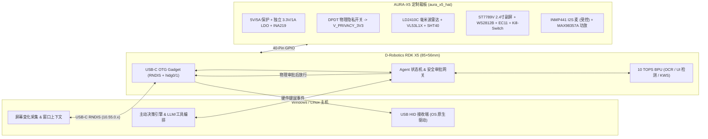

# AURA-X5 · 桌面级具身主动式 AI 协作者（产品与系统架构）

> 版本：1.0.0-EVT-A  
> 核心算力：D-Robotics RDK X5（10 TOPS BPU + 8-Core Cortex-A55）  
> 契约入口：`../interfaces.json`

## 1. 为什么是“依托电脑存在的主动式 Agent 硬件”？

纯软件桌面 Agent 存在三个天然短板：
1. **算力与隐私冲突**：持续屏幕理解/视觉感知占用 PC GPU/CPU，且用户对常驻麦克风/摄像头存在心理防线。
2. **主屏打断**：主动建议以弹窗/浮窗形式出现在工作区，打断心流。
3. **执行权限不可控**：软件层模拟键鼠容易被 UAC/全屏应用拦截，且缺乏物理级的“一键急停/物理授权”锚点。

**AURA-X5** 将 RDK X5 变成桌面上的**物理第二大脑**：
- **10 TOPS BPU 算力卸载**：屏幕语义切片（OCR/UI 目标检测）、近场语音唤醒（VAD/KWS）、用户存在与姿态感知全部在 RDK X5 端侧完成。
- **物理级隐私主权**：前面板 **DPDT 硬件隐私拨动开关** 直接切断麦克风与摄像头供电轨 `V_PRIVACY_3V3`，并硬件点亮红色隐私灯，任何软件漏洞均无法窃听。
- **硬件级 USB-C 协同**：通过 RDK X5 USB 2.0 Type-C OTG 接口模拟 **USB Composite Gadget（RNDIS/ECM 虚拟网卡 + HID 硬件键盘/鼠标）**。一根线直连 PC，既能高速传输屏幕上下文，又能在用户**按下实体旋钮确认**后，以真实硬件键鼠执行跨应用操作；按下实体 **Kill-Switch** 立即物理中断执行队列。
- **零打扰桌面副屏交互**：15° 仰角 2.4" IPS 副屏 + 8 颗 WS2812B 环形光环 + EC11 旋钮，将主动建议、算力负载、功耗、环境与专注度状态优雅地呈现在主屏之外。

## 2. 系统总体架构

## 3. 全流程工程交付规划

1. **机械结构与 3D 建模（`mechanical/`）**：基于 `CadQuery 2.8.0` 参数化生成 15° 倾角桌面控制台外壳（底座、风道中框、前倾面板、副屏/雷达/旋钮支架），导出制造级 `STEP` + `STL`，并执行 3D 干涉/装配间隙检查与多视角渲染。
2. **电子电路与 PCB 设计（`electronics/`）**：基于 `KiCad 9.0.7` 生成定制载板 `aura_x5_hat` 原理图、PCB 布局布线、ERC/DRC 零报错校验、JLCPCB 标准 BOM/坐标文件与 Gerber/钻孔生产包。
3. **嵌入式软件与 BPU 服务（`firmware/`）**：RDK X5 端 USB Composite Gadget 配置脚本、40-Pin 外设驱动（ST7789V / EC11 / WS2812B / LD2410C / VL53L1X / SHT40 / INA219）、10 TOPS BPU 推理服务（含模型加载与真实推理管线）与硬件审批安全状态机。
4. **PC 宿主软硬件集成（`host/`）**：Windows 端主动式桌面上下文采集（变化检测 + 活跃窗口）、WebSocket/USB 双向通信守护进程、主动建议生成与硬件审批闭环。
5. **实物验证与 Bring-up（`verification/`）**：端到端接口一致性审计脚本、PC-RDK 联调仿真与 HIL 测试套件、分阶段物理上电/散热/整机验收表。
