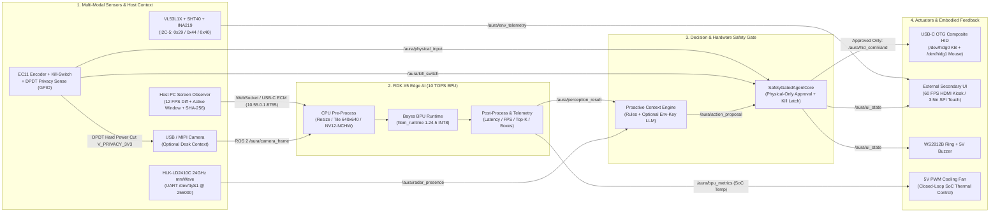
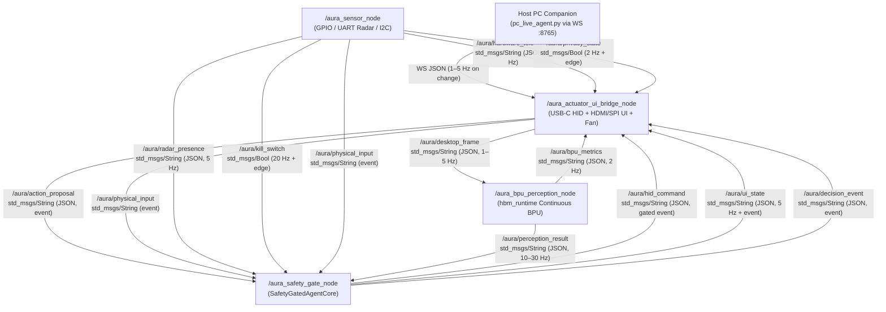

# Stage 2 — AI System Architecture & ROS 2 Design: AURA-X5

> **Official Requirement:** [`stages/stage2-build.md` — Challenge 2](https://github.com/D-Robotics/Robotics-Dream-Keeper-Challenge-Winter/blob/main/stages/stage2-build.md)  
> **Hardware & Pinout Contract:** [`interfaces.json`](../interfaces.json)  
> **ROS 2 Implementation Package:** [`ros2_ws/src/aura_x5_ros/`](../ros2_ws/src/aura_x5_ros/)

---

## 1. End-to-End Data-Flow Diagram (Sensors → AI → Decision → Actuators)

---

## 2. Module Responsibilities, Interfaces & Failure Modes

| Module | Owner File(s) | Inputs | Outputs | Failure Modes & Fail-Fast Handling |
|---|---|---|---|---|
| **Host Screen Observer** | `host/pc_daemon.py`, `host/pc_live_agent.py` | OS desktop framebuffer, active foreground window title | `FrameEvent` (`frame_id`, `timestamp`, `sha256`, `diff_ratio`, JPEG thumb) over WS `8765` | **WS disconnect**: auto-retry with backoff, RDK UI flips `connected_pc=False` (`STANDBY`). **Static screen**: filtered out (`diff < 0.02`) to avoid BPU waste. |
| **Sensor & GPIO Hub (`aura_sensor_node`)** | `ros2_ws/src/aura_x5_ros/aura_x5_ros/sensor_node.py`, `firmware/hal_devices.py`, `firmware/sensors_full.py`, `firmware/sensor_hub.py` | GPIO Pins 7/13/15/16/29, UART `/dev/ttyS1`, I2C-5 (`0x29`/`0x40`/`0x44`) | ROS 2 topics `/aura/hardware_telemetry`, `/aura/radar_presence`, `/aura/privacy_state`, `/aura/kill_switch`, `/aura/physical_input` | **Missing sensor / I2C NACK / CRC-8 mismatch**: explicitly reports `connected=false` / `null` (never fabricates fake values). **Kill-Switch pressed**: immediate high-priority `Bool(True)` event. |
| **BPU Perception (`aura_bpu_perception_node`)** | `ros2_ws/src/aura_x5_ros/aura_x5_ros/bpu_perception_node.py`, `firmware/bpu_vision.py` | Incoming frame stream (`/aura/desktop_frame` or continuous test/camera buffer) | `/aura/perception_result` (JSON with `frame_id`, class/boxes, `latency_ms`), `/aura/bpu_metrics` (FPS, BPU load, SoC temp) | **Missing `hbm_runtime` or `.bin`/`.hbm` file**: raises `BPUUnavailableError` and publishes `status=BPU_UNAVAILABLE` — **zero silent CPU fallback**. **Thermal > 75 °C**: triggers high-duty fan alert & throttles non-critical inference rate. |
| **Proactive Context Engine** | `host/proactive_engine.py` | `FrameEvent`, active window title, BPU perception result, radar presence | `ProactiveProposal` (`proposal_id`, `title`, `summary`, `action_type`, `hid_actions`, `evidence_frame_id`) + JSONL audit log | **LLM API timeout / missing key**: cleanly falls back to deterministic rule engine (`IDE Ctrl+S`, `45-min Focus Break`, context card) without blocking real-time loop. |
| **Safety Gate (`aura_safety_gate_node`)** | `ros2_ws/src/aura_x5_ros/aura_x5_ros/safety_gate_node.py`, `firmware/agent_core.py` | `/aura/action_proposal`, `/aura/physical_input`, `/aura/kill_switch`, `/aura/reset_kill_latch` service | `/aura/hid_command` (gated), `/aura/ui_state`, `/aura/decision_event` | **Non-physical approval source (`remote_api`)**: raises `PermissionError` and blocks execution. **Kill-Switch pressed**: latches `kill_latched=True`, aborts queue, sends immediate `release_all_hid_keys` command. |
| **Actuator & UI Bridge (`aura_actuator_ui_bridge_node`)** | `ros2_ws/src/aura_x5_ros/aura_x5_ros/actuator_ui_bridge_node.py`, `firmware/hdmi_server.py`, `firmware/hid_actions.py`, `ui_web/index.html` | `/aura/hid_command`, `/aura/ui_state`, `/aura/bpu_metrics`, `/aura/hardware_telemetry` | `/dev/hidg0` 8-byte boot keyboard reports, HDMI HTTP `8080` + WS `8765`, SPI 3.5" LCD, PWM fan (`Pin 32`), WS2812B RGB | **`/dev/hidg0` absent**: reports `HID_NOT_CONFIGURED` cleanly without crashing UI. **Mid-macro abort**: unconditionally writes `b"\x00"*8` release report to prevent stuck modifier keys. |

---

## 3. Compute Allocation Plan (BPU vs CPU vs Justified Off-Board PC)

| Compute Unit | Assigned Workloads | Justification |
|---|---|---|
| **RDK X5 Bayes BPU (10 TOPS INT8)** | Continuous real-time visual inference (`hbm_runtime`: MobileNetV2 / YOLOv8 / PP-OCRv5 640×640 tiles), optional on-device KWS | Offloads continuous vision off the host PC GPU/CPU and guarantees deterministic low-latency edge inference (`< 15 ms` per frame for MobileNetV2 / `< 50 ms` for YOLOv8s) |
| **RDK X5 8-Core Cortex-A55 CPU** | ROS 2 Humble node orchestration, image decode/resize/tiling, UART/I2C/GPIO HAL polling, `SafetyGatedAgentCore`, USB-C `libcomposite` HID driver, HTTP/WS server for 60 FPS HDMI UI | Low-overhead I/O, deterministic safety state machine, and hardware peripheral control isolated from host OS crashes |
| **Host PC (Off-Board, Justified)** | Native Windows/Linux desktop framebuffer capture (`ImageGrab` / `ddagrab` 12 FPS), foreground window title query, pixel diff filtering, optional cloud/local LLM text reasoning | **Why off-board is justified**: only the host OS holds desktop screen buffers and foreground window handles. By sending only filtered change crops/thumbnails to RDK X5 (and never raw continuous video to cloud), bandwidth and privacy exposure stay minimal |

---

## 4. ROS 2 Architecture (Node Graph, Topics, Services & Rates)

### ROS 2 Node Graph

### ROS 2 Topics & Services Specification

| Name | Kind | Message / Service Type | Publisher / Server | Subscriber / Client | Expected Rate | QoS / Notes |
|---|---|---|---|---|---|---|
| `/aura/desktop_frame` | Topic | `std_msgs/msg/String` (JSON envelope with `frame_id`, `ts_ns`, `sha256`, base64 crop) | `/aura_actuator_ui_bridge_node` | `/aura_bpu_perception_node` | `1–5 Hz` (event-driven on screen diff) | Best-effort, depth=2 |
| `/aura/perception_result` | Topic | `std_msgs/msg/String` (JSON: `frame_id`, `ts_ns`, `model`, `latency_ms`, `top_class`, `score`) | `/aura_bpu_perception_node` | `/aura_safety_gate_node`, `/aura_actuator_ui_bridge_node` | `10–30 Hz` (continuous BPU stream) | Reliable, depth=5 |
| `/aura/bpu_metrics` | Topic | `std_msgs/msg/String` (JSON: `fps`, `avg_ms`, `p95_ms`, `bpu_ready`, `soc_temp_c`, `cpu_pct`) | `/aura_bpu_perception_node` | `/aura_actuator_ui_bridge_node` | `2 Hz` | Reliable, depth=5 |
| `/aura/hardware_telemetry` | Topic | `std_msgs/msg/String` (JSON: I2C/UART/HID presence, temp/RH, voltage) | `/aura_sensor_node` | `/aura_actuator_ui_bridge_node` | `2 Hz` | Reliable, depth=5 |
| `/aura/radar_presence` | Topic | `std_msgs/msg/String` (JSON: `ts_ns`, `user_present`, `moving_cm`, `static_cm`) | `/aura_sensor_node` | `/aura_safety_gate_node`, `/aura_actuator_ui_bridge_node` | `5 Hz` | Reliable, depth=5 |
| `/aura/privacy_state` | Topic | `std_msgs/msg/Bool` (`True`=mic/cam powered, `False`=physically cut) | `/aura_sensor_node` | `/aura_actuator_ui_bridge_node` | `2 Hz` + edge change | Reliable, transient local |
| `/aura/kill_switch` | Topic | `std_msgs/msg/Bool` (`True`=emergency stop triggered) | `/aura_sensor_node` | `/aura_safety_gate_node`, `/aura_actuator_ui_bridge_node` | `20 Hz` poll / immediate edge | Reliable, high priority |
| `/aura/physical_input` | Topic | `std_msgs/msg/String` (JSON: `source` in `ec11_press`/`xpt2046_touch`/`hdmi_local_confirm`/`ec11_rotate`, `decision`) | `/aura_sensor_node`, `/aura_actuator_ui_bridge_node` | `/aura_safety_gate_node` | Event-driven | Reliable, depth=10 |
| `/aura/action_proposal` | Topic | `std_msgs/msg/String` (JSON `ActionProposal`) | `/aura_actuator_ui_bridge_node` | `/aura_safety_gate_node` | Event-driven | Reliable, depth=10 |
| `/aura/hid_command` | Topic | `std_msgs/msg/String` (JSON `hid_actions` or `release_all`) | `/aura_safety_gate_node` | `/aura_actuator_ui_bridge_node` | Gated event only | Reliable, depth=10 |
| `/aura/ui_state` | Topic | `std_msgs/msg/String` (JSON UI snapshot) | `/aura_safety_gate_node` | `/aura_actuator_ui_bridge_node` | `5 Hz` + on state change | Reliable, depth=5 |
| `/aura/reset_kill_latch` | Service | `std_srvs/srv/Trigger` | `/aura_safety_gate_node` | Operator CLI / Local UI | On-demand recovery | Requires explicit manual call |

### Multi-Sensor Time Synchronization Approach
- Every ROS 2 payload carries a monotonic RDK X5 node clock timestamp `ts_ns = self.get_clock().now().nanoseconds` alongside the host `frame_id` and `sha256` hash.
- `/aura_safety_gate_node` correlates incoming `/aura/perception_result`, `/aura/radar_presence`, and `/aura/physical_input` within a configurable freshness window (`max_sync_skew_ms: 500 ms` in `config/aura_x5_params.yaml`). Stale proposals older than `proposal_ttl_sec: 120 s` expire automatically so an accidental late press never fires an outdated keystroke macro.
