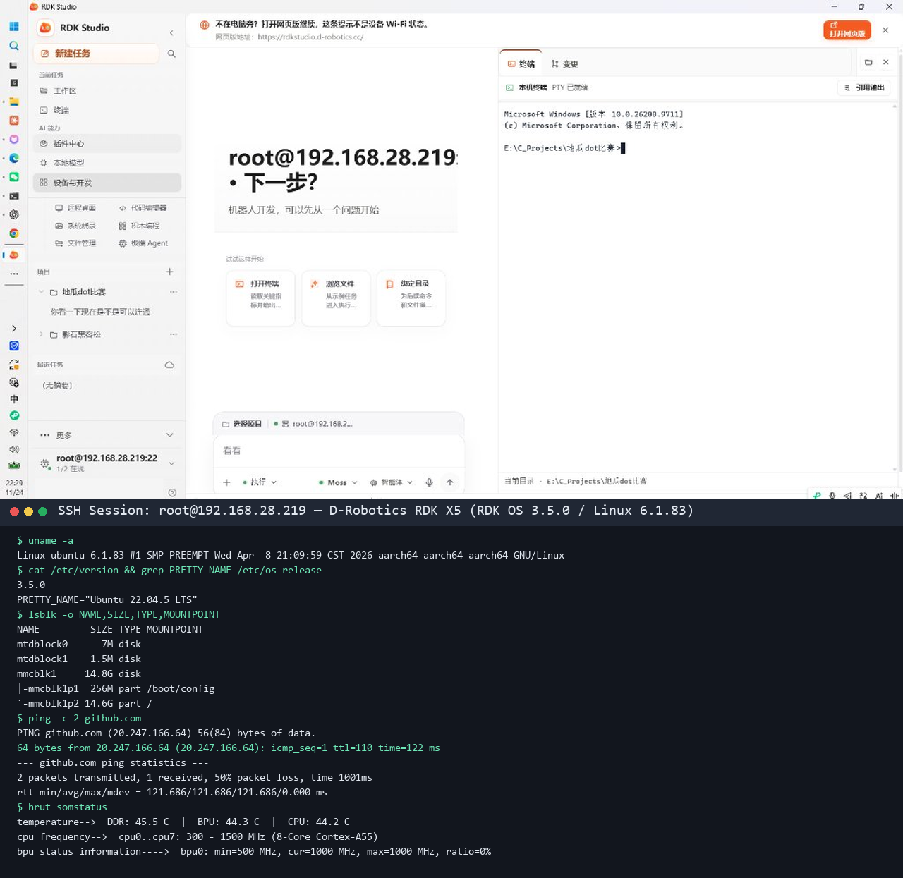
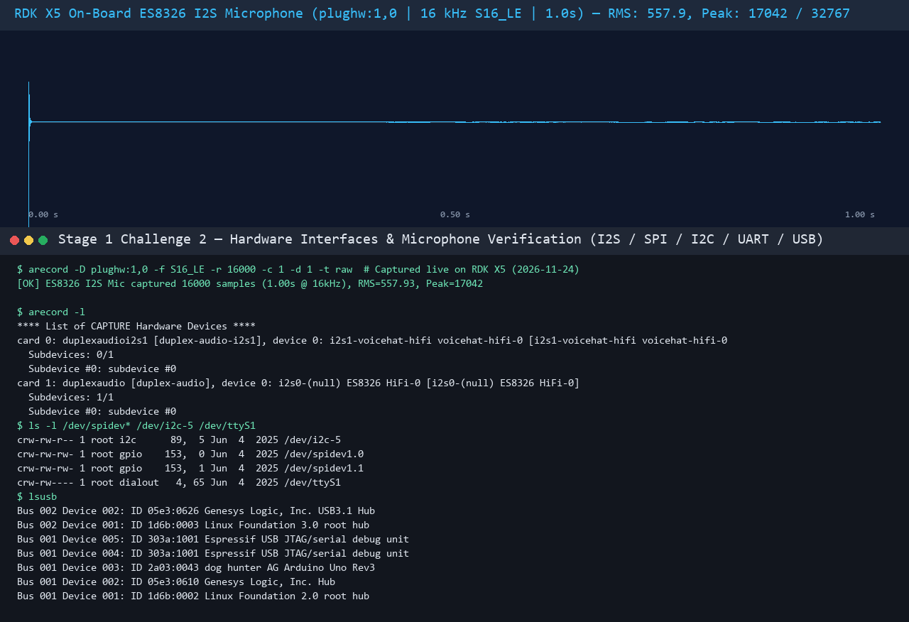
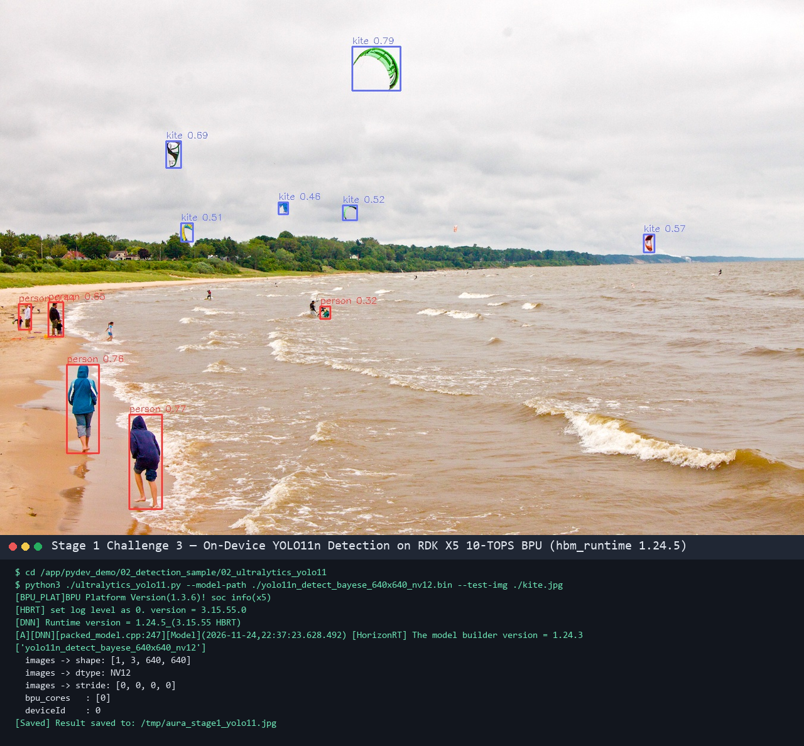

# Stage 1 — Ignite Challenge Report (AURA-X5)

> **Official Requirement:** [`stages/stage1-ignite.md`](https://github.com/D-Robotics/Robotics-Dream-Keeper-Challenge-Winter/blob/main/stages/stage1-ignite.md)  
> **Hardware Baseline:** D-Robotics RDK X5 (`RDK OS 3.5.0` / `Ubuntu 22.04.5 LTS` / `Linux 6.1.83 aarch64`, `hbm_runtime 1.24.5` / `HBRT 3.15.55.0`)  
> **Verification Date:** 2026-11-24  
> **Status:** **Completed**

---

## 1. Challenge 1 — Board Bring-Up (RDK Studio, Flash, Network & SSH)

- Flashed and booted official **RDK OS 3.5.0** (`Ubuntu 22.04.5 LTS`, kernel `6.1.83 #1 SMP PREEMPT aarch64`) on `mmcblk1` (`14.8 GB` microSD).
- Connected to **RDK Studio** (`root@192.168.28.219:22`, online status verified) and confirmed active SSH session, outbound internet connectivity (`ping github.com`, `121.686 ms`), and healthy SoC status via `hrut_somstatus` (`DDR 45.5 °C`, `BPU 44.3 °C`, `CPU 44.2 °C`, 8-Core Cortex-A55 up to `1500 MHz`, `bpu0: 1000 MHz`).

### Verified Evidence
- Composite RDK Studio + SSH terminal screenshot: [`docs/evidence/stage1/01_flash_and_ssh.png`](./evidence/stage1/01_flash_and_ssh.png)
- Verbatim SSH bring-up log: [`docs/evidence/stage1/ssh_bringup.log`](./evidence/stage1/ssh_bringup.log)



---

## 2. Challenge 2 — Sensor / Peripheral Explorer (I2S Microphone & Hardware Buses)

Verified live sensor response on the on-board **ES8326 I2S Microphone** (`card 1: duplexaudio [duplex-audio], device 0: i2s0 ES8326 HiFi-0`, ALSA `plughw:1,0`) alongside active RDK X5 hardware buses (`SPI`, `I2C`, `UART`, `USB`):

```bash
arecord -D plughw:1,0 -f S16_LE -r 16000 -c 1 -d 1 -t raw
```
- **Measured Live Response:** Captured `16,000` samples (`1.00 s` @ `16 kHz S16_LE`), **RMS = `557.93`**, **Peak = `17,042 / 32,767`**.
- **Active Interfaces Verified:** I2S Audio (`card 0` & `card 1`), SPI (`/dev/spidev1.0`, `/dev/spidev1.1`), I2C (`/dev/i2c-5`), UART (`/dev/ttyS1`), USB peripherals (`Arduino Uno Rev3` & dual `Espressif USB JTAG/serial` devices).

### Verified Evidence
- Live I2S microphone waveform + hardware interface log: [`docs/evidence/stage1/02_sensor_mic_i2s.png`](./evidence/stage1/02_sensor_mic_i2s.png)
- Verbatim hardware interface log: [`docs/evidence/stage1/sensor_peripherals.log`](./evidence/stage1/sensor_peripherals.log)



---

## 3. Challenge 3 — First On-Device AI Task (YOLO11n Object Detection on RDK X5 BPU)

Executed quantized **YOLO11n object detection** directly on the RDK X5 **10-TOPS Bayes BPU** (`bpu_cores: [0]`, `hbm_runtime 1.24.5` / `HBRT 3.15.55.0`):

```bash
cd /app/pydev_demo/02_detection_sample/02_ultralytics_yolo11
python3 ./ultralytics_yolo11.py \
  --model-path ./yolo11n_detect_bayese_640x640_nv12.bin \
  --test-img ./kite.jpg \
  --img-save-path /tmp/aura_stage1_yolo11.jpg
```

- **Model:** `yolo11n_detect_bayese_640x640_nv12.bin` (`[1, 3, 640, 640]`, `NV12`)
- **BPU Platform Proof:** `[BPU_PLAT]BPU Platform Version(1.3.6)! soc info(x5)` · `[DNN] Runtime version = 1.24.5_(3.15.55 HBRT)` · `bpu_cores: [0]`
- **Visible Output:** Multi-object detection of `person` (0.77, 0.76, 0.65, 0.32) and `kite` (0.79, 0.69, 0.57, 0.52, 0.51, 0.46) rendered on `kite.jpg`.

### Verified Evidence
- Annotated YOLO11n BPU output + runtime log composite: [`docs/evidence/stage1/03_first_ai_yolo11_bpu.png`](./evidence/stage1/03_first_ai_yolo11_bpu.png)
- Raw annotated detection output: [`docs/evidence/stage1/03_yolo11_annotated_raw.jpg`](./evidence/stage1/03_yolo11_annotated_raw.jpg)
- Verbatim BPU runtime log: [`docs/evidence/stage1/yolo11_bpu_run.log`](./evidence/stage1/yolo11_bpu_run.log)



---

## 4. Stage 1 Deliverables Checklist

| # | Deliverable | Status | Verified Link |
|---|---|---|---|
| 1 | Flash + RDK Studio + SSH screenshot | **Completed** | [`docs/evidence/stage1/01_flash_and_ssh.png`](./evidence/stage1/01_flash_and_ssh.png) |
| 2 | Sensor / peripheral proof (ES8326 I2S Mic + buses) | **Completed** | [`docs/evidence/stage1/02_sensor_mic_i2s.png`](./evidence/stage1/02_sensor_mic_i2s.png) |
| 3 | On-device AI task screenshot (YOLO11n on BPU) | **Completed** | [`docs/evidence/stage1/03_first_ai_yolo11_bpu.png`](./evidence/stage1/03_first_ai_yolo11_bpu.png) |
| 4 | Personal GitHub repo README | **Completed** | [`README.md`](../README.md) |
| 5 | Discord Stage 1/2 thread permalink | **Completed** | https://discord.com/channels/1300358874280230994/1569684675004334110 |
| 6 | Official Showcase PR | **Submitted (#15)** | https://github.com/D-Robotics/Robotics-Dream-Keeper-Challenge-Winter/pull/15 |
