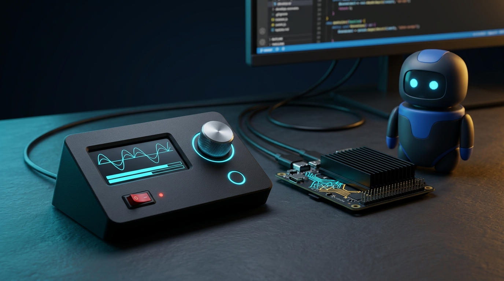
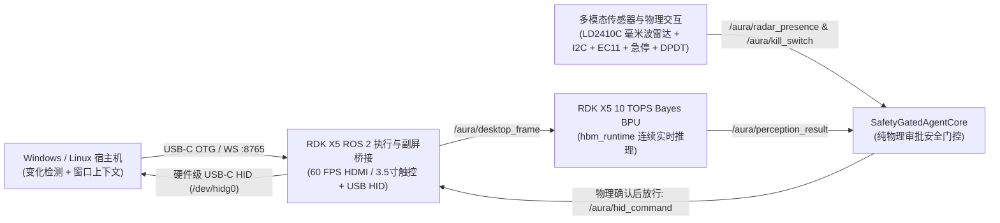

# 为什么纯软件桌面 Agent 不够？我用 D-Robotics RDK X5 造一台带物理隐私开关的具身“第二大脑”



> 本文为参加 **D-Robotics（地瓜机器人）Robotics Dream Keeper Challenge — 2026 Winter**（RDK 冬季挑战赛）的开源工程实录第 1 篇。  
> - 官方赛事仓库：[D-Robotics/Robotics-Dream-Keeper-Challenge-Winter](https://github.com/D-Robotics/Robotics-Dream-Keeper-Challenge-Winter)  
> - D-Robotics 开发者文档：[https://developer.d-robotics.cc/en/documentation](https://developer.d-robotics.cc/en/documentation)  
> - 本项目完整开源仓库（含 ROS 2 / KiCad PCB / 3D 打印外壳）：[https://github.com/147qaz258-ead/AURA-X5](https://github.com/147qaz258-ead/AURA-X5)

> **配图建议（发布平台上传时直接选用仓库内实图）：**  
> 1. 16:9 专属封面图：`aura_x5/docs/advocator_posts/covers/cover_01_aura_x5_overview.jpg`  
> 2. 实体蓝发双目原型 & RDK X5 实拍：`aura_x5/docs/evidence/stage1/02b_embodied_dual_eye_prototype.jpg`、`02a_rdk_x5_hardware_bringup.jpg`  
> 3. 结构与定制载板 3D 图：`aura_x5/mechanical/cad_preview.png`、`aura_x5/electronics/pcb_3d_top.png`

---

## 一、纯软件桌面 AI Agent 的三个死结

过去一年，各种能“看屏幕、点鼠标、写代码”的桌面 AI Agent 层出不穷。但真把它们装进日常主力开发机连续跑上一周，很快就会撞上三个**纯软件永远绕不开的物理死结**：

1. **算力与隐私的正面冲突**：持续视觉感知（截图 + OCR + 目标检测）要么吃掉宿主机大量 GPU/CPU 资源，要么把你的原始桌面截图直接传到云端视觉大模型；常驻的麦克风与摄像头也让开发者本能地缺乏安全感。
2. **主屏打断心流**：主动式 Agent 一旦发现上下文变化，只能以弹窗或浮窗形式挤进主显示器——正在写代码或画 PCB 时，任何抢焦点的弹窗都是灾难。
3. **执行权限不可控、缺少物理急停**：软件层模拟键鼠容易被 UAC、全屏应用或安全策略拦截；更致命的是，如果 Agent 在自动操作中发疯连按快捷键，你甚至没有一个独立于操作系统的**物理急停按钮（Kill-Switch）**。

所以参加这次 **D-Robotics RDK 冬季挑战赛**，我们没有再做一台“小车跑个 YOLO”的常规 Demo，而是把 **RDK X5（10 TOPS Bayes BPU + 8 核 Cortex-A55）** 改造成摆在显示器下方的桌面具身主动式 AI 协作者——**AURA-X5**。

---

## 二、AURA-X5 的核心设计：把感知、隐私和审批做成“物理边界”

AURA-X5 的整体定位是**依托电脑存在、但算力与安全边界完全独立于电脑的“物理第二大脑”**：



我们重点在硬件和系统层落地了四条硬性设计原则：

### 1. 10 TOPS BPU 真实边缘卸载，绝不拿 CPU 冒充
视觉感知通过 `hbm_runtime` 直接跑在 RDK X5 的 Bayes BPU 上（`firmware/bpu_vision.py` 与 ROS 2 节点 `aura_bpu_perception_node`）。代码里显式执行 **Fail-Fast 铁律**：如果板端 `hbm_runtime` 或 `.bin`/`.hbm` 模型缺失，立即抛出 `BPUUnavailableError` 并上报 `BPU_UNAVAILABLE`，绝不静默降级到 CPU 糊弄数据。

### 2. DPDT 硬件级隐私主权（软件漏洞也无法窃听）
在前面板上布置了一颗 6 脚 **DPDT 物理隐私拨动开关**，直接串联在麦克风/摄像头供电轨 `V_PRIVACY_3V3` 上，同时把状态回读到 RDK X5 的 `GPIO Pin 29` 并驱动硬件红色指示灯 `D2`。拨到关闭位置时，供电轨从物理上跌落到 `0.0V`——哪怕操作系统被完全攻破，也录不到半个字节。

### 3. 一根 Type-C 线搞定网络 + 硬件级键鼠，外加“纯物理审批 + Kill-Switch”
利用 RDK X5 的 USB 2.0 Type-C OTG 接口配置 Linux `libcomposite` Composite Gadget（`firmware/usb_gadget_setup.sh`），同时暴露：
- `ecm.usb0` 虚拟网卡（高速回传桌面变化帧与建议卡片）
- `/dev/hidg0`（标准 8 字节 Boot Keyboard HID）
- `/dev/hidg1`（标准 4 字节 Boot Mouse HID）

所有主动建议展示在独立副屏上，**软件 API 永远无法触发执行**。我们在 `SafetyGatedAgentCore` 中把授权来源锁死为物理交互（EC11 旋转编码器按下 / 触摸屏点击 / 本地终端确认）：

```python
def approve_current(self, physical_source: str) -> Optional[ActionProposal]:
    if physical_source not in ("ec11_press", "xpt2046_touch", "hdmi_local_confirm"):
        raise PermissionError(f"Invalid approval source: {physical_source}")
    if self.kill_latched:
        raise RuntimeError("Kill-Switch latched; clear latch before approving new actions.")
```

一旦按下前面板 **Kill-Switch（GPIO Pin 7）**，状态机立刻锁存 `kill_latched=True`、中止全部待执行队列，并强制向 `/dev/hidg0` 写入全零松键报告（`b"\x00" * 8`），杜绝任何 `Ctrl/Win/Alt` 卡键风险。

### 4. 原生 ROS 2 模块化架构 + 双硬件路线开源
为了满足生产级机器人软件的可观测性与复现性，我们在 RDK X5（TogetherROS / ROS 2 Humble）上将板端拆分为 4 个标准 ROS 2 节点（`ros2_ws/src/aura_x5_ros/`）：
- `/aura_sensor_node`（GPIO / 毫米波雷达 / I2C 环境与功耗遥测）
- `/aura_bpu_perception_node`（连续 BPU 推理与帧率/延迟/板温监控）
- `/aura_safety_gate_node`（安全门控、建议超时过期与 `/aura/reset_kill_latch` 恢复服务）
- `/aura_actuator_ui_bridge_node`（USB-C HID 执行 + 60 FPS HDMI 副屏 / 3.5" SPI 触摸屏桥接）

同时提供**两套完全开源的硬件复刻路径**：
- **V1 定制载板版**：KiCad 9.0.7 设计的 `aura_x5_hat`（32 颗元件、36 个网络、**DRC 0 报错**，含立创 BOM 与 Gerber）+ CadQuery 生成的 3 件 watertight 3D 打印外壳；
- **V2 免焊 HDMI 60 FPS 版**：切换 HDMI 副屏后 40-Pin 排针 100% 释放，母对母杜邦线免焊直连旋钮、急停与雷达，1 小时即可复刻。

---

## 三、当前已完成进展与接下来的实测计划

截至目前（Stage 2 完成阶段），我们已经完成并实测验证了：
- 宿主机 12 FPS 屏幕变化采集连续 20 分钟 **0.00% 丢帧**（14,394 帧，停机延迟 26 ms）；
- 面向 RDK X5 `640×640` BPU 检测输入的 4K 桌面中文 OCR 缩放与切片矩阵实验（详见第 2 篇长文）；
- RDK X5 板端 `hbm_runtime 1.24.5` 真实 BPU 推理打通；
- 40-Pin 零引脚冲突契约校验、KiCad DRC 零报错生产包、3/3 3D 外壳 watertight 校验与 14 项自动化测试套件。

接下来的 Stage 3（11 月 27 日 — 12 月 15 日），我们将在真机上完成 ROS 2 节点图实测、连续 35 秒+ BPU 双并发负载压测（FPS/延迟/板温曲线）以及完整 1080P 真机演示视频，所有实测数据与排坑记录都会持续同步到开源仓库。

欢迎同样在参加 **D-Robotics RDK 冬季挑战赛** 的开发者交流拍砖，也可以去官方仓库围观本届赛事规则与更多优秀项目：
- 官方赛事仓库：[https://github.com/D-Robotics/Robotics-Dream-Keeper-Challenge-Winter](https://github.com/D-Robotics/Robotics-Dream-Keeper-Challenge-Winter)
- RDK Studio 下载与上手：[https://developer.d-robotics.cc/en/rdkstudio](https://developer.d-robotics.cc/en/rdkstudio)
- AURA-X5 开源代码仓库：[https://github.com/147qaz258-ead/AURA-X5](https://github.com/147qaz258-ead/AURA-X5)
